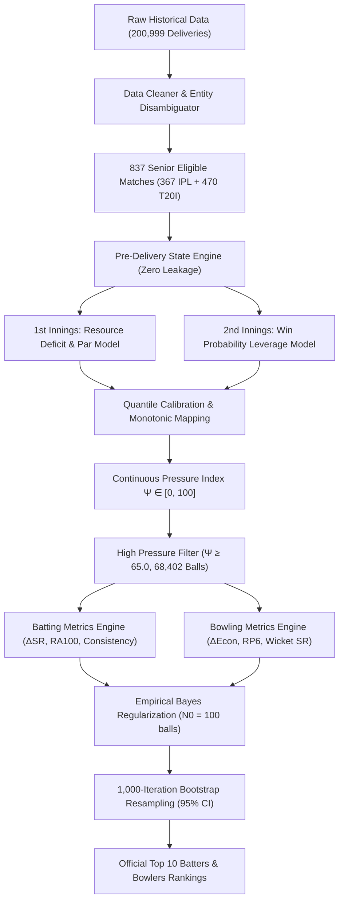

<div align="center">

# 👑 SupeRR Selector Season 2
### Cricket Pressure Intelligence Platform &middot; Rajasthan Royals Official Challenge

[](https://superrr-selector.vercel.app)
[](https://github.com/Pranavgaikwad007/superrr-selector)
[](https://www.python.org/)
[](https://docs.pytest.org/)
[](https://react.dev/)
[](https://www.typescriptlang.org/)
[](https://tailwindcss.com/)

<p align="center">
  <strong>An end-to-end Machine Learning and Sports Analytics platform that isolates true clutch performers from high-volume accumulators under high-pressure match situations.</strong>
</p>

[**Explore Live Dashboard**](https://superrr-selector.vercel.app) &bull; [**Read Methodology PDF**](reports/final_methodology_report.pdf) &bull; [**Unstop Dropdown File**](outputs/UNSTOP_FINAL_RANKINGS.txt) &bull; [**Verification Checklist**](outputs/final_submission_checklist.md)

---

</div>

## 🎯 Executive Overview & Core Findings

In high-stakes Twenty20 cricket, aggregate averages flatten context. Scoring 40 off 20 when cruising at 8 RRR with 9 wickets in hand is routine; scoring 22 off 9 balls in a playoff knockout with 6 down requires elite nerve and execution.

The **SupeRR Selector Pressure Intelligence System (CPIS)** audits **883 scheduled fixtures (837 eligible senior IPL & T20I matches with delivery data)** and **194,014 deliveries** since 2022. It models real-time win probability and resource deficit strictly **prior to delivery release (zero future data leakage)** to evaluate 291 qualified cricketers.

```
       ┌────────────────────────────────────────────────────────────────────────┐
       │                 🏆 2026 UNSTOP OFFICIAL CHAMPIONS                      │
       ├────────────────────────────────────┬───────────────────────────────────┤
       │ #1 PRESSURE BATTER                 │ #1 PRESSURE BOWLER                │
       │ 🏏 Yashasvi Jaiswal (RR / IND)     │ 🎯 Jamie Overton (ENG / CSK)      │
       │ • Score: 84.17 / 100               │ • Score: 85.13 / 100              │
       │ • Pressure SR: 179.71 (+23.35 Δ)   │ • Pressure Econ: 6.25 (-1.97 Δ)   │
       │ • Context Runs Added/100b: +39.41  │ • Runs Prevented/6b: +2.01 runs   │
       │ • 95% Bootstrap CI: [71.7, 96.7]   │ • 95% Bootstrap CI: [70.9, 99.4]  │
       │ • Boundary Rate: 28.6%             │ • Wicket SR: 10.60 balls/wicket   │
       └────────────────────────────────────┴───────────────────────────────────┘
```

---

## 🏆 Official Top 10 Rankings

### 🏏 Top 10 Batters Under Pressure

| Rank | Player Name | Franchise / Nation | Reliability Score | 95% Bootstrap CI | Pressure Balls | $\text{SR}_{\text{press}}$ | Baseline SR | $\Delta\text{SR}$ | $\text{RA}_{100}$ | Boundary % | Dot % |
| :---: | :--- | :--- | :---: | :---: | :---: | :---: | :---: | :---: | :---: | :---: | :---: |
| 🥇 **1** | **Yashasvi Jaiswal** | Rajasthan Royals / India | **84.17** | [71.66, 96.68] | 276 | **179.71** | 156.36 | **+23.35** | **+39.41** | 28.62% | 26.09% |
| 🥈 **2** | **Prabhsimran Singh** | Punjab Kings | **81.40** | [68.28, 94.52] | 251 | **178.09** | 160.05 | **+18.03** | **+38.34** | 27.09% | 27.49% |
| 🥉 **3** | **Abhishek Sharma** | Sunrisers Hyderabad / India | **76.44** | [63.65, 89.23] | 264 | **185.23** | 186.49 | -1.27 | **+49.74** | 28.41% | 28.41% |
| **4** | **Naman Dhir** | Mumbai Indians / India | **76.11** | [62.00, 90.22] | 217 | **182.95** | 172.04 | **+10.91** | **+37.01** | 26.27% | 24.88% |
| **5** | **Quinton de Kock** | Lucknow Super Giants / SA | **73.97** | [60.49, 87.45] | 238 | **166.81** | 150.87 | **+15.94** | **+33.40** | 23.95% | 28.15% |
| **6** | **Suryakumar Yadav** | India / Mumbai Indians | **72.79** | [65.33, 80.25] | **777** | **165.77** | 166.43 | -0.66 | **+30.46** | 23.42% | 27.93% |
| **7** | **Reeza Hendricks** | South Africa | **71.69** | [57.34, 86.04] | 210 | **156.67** | 146.59 | **+10.08** | **+30.57** | 20.00% | 26.67% |
| **8** | **Heinrich Klaasen** | Sunrisers Hyderabad / SA | **70.51** | [61.66, 79.36] | 552 | **167.03** | 166.76 | +0.27 | **+29.48** | 22.46% | 25.91% |
| **9** | **Ajinkya Rahane** | KKR / Chennai Super Kings | **69.06** | [53.43, 84.69] | 177 | **163.28** | 139.12 | **+24.15** | **+27.82** | 18.64% | 25.42% |
| **10** | **Mohammad Rizwan** | Pakistan | **68.84** | [56.92, 80.76] | 304 | **147.70** | 127.34 | **+20.35** | **+19.85** | 15.46% | 23.03% |

---

### 🎯 Top 10 Bowlers Under Pressure

| Rank | Player Name | Franchise / Nation | Reliability Score | 95% Bootstrap CI | Pressure Overs | $\text{Econ}_{\text{press}}$ | Baseline Econ | $\Delta\text{Econ}$ | $\text{RP}_6$ | Dot % | Wicket SR |
| :---: | :--- | :--- | :---: | :---: | :---: | :---: | :---: | :---: | :---: | :---: | :---: |
| 🥇 **1** | **Jamie Overton** | England / CSK | **85.13** | [70.85, 99.41] | 35.3 ov (212b) | **6.25** | 8.22 | **-1.97** | **+2.01** | **49.53%** | **10.60** |
| 🥈 **2** | **Sunil Narine** | Kolkata Knight Riders | **83.93** | [75.98, 91.88] | 114.0 ov (684b)| **5.87** | 6.76 | **-0.89** | **+2.40** | 40.94% | 18.00 |
| 🥉 **3** | **Abrar Ahmed** | Pakistan | **81.74** | [70.08, 93.40] | 53.0 ov (318b) | **5.51** | 6.57 | **-1.06** | **+2.04** | 44.03% | 16.74 |
| **4** | **Sufiyan Muqeem** | Pakistan | **76.68** | [59.65, 93.71] | 24.8 ov (149b) | **5.60** | 6.37 | **-0.77** | **+2.05** | **53.69%** | **11.46** |
| **5** | **Mujeeb Ur Rahman** | Afghanistan / Mumbai Indians | **74.94** | [61.11, 88.77] | 37.7 ov (226b) | **6.08** | 6.78 | **-0.70** | **+1.61** | 44.25% | 12.56 |
| **6** | **Kuldeep Yadav** | Delhi Capitals / India | **73.08** | [66.23, 79.93] | **153.5 ov (921b)**| **6.94** | 7.84 | **-0.90** | **+1.13** | 36.16% | 14.62 |
| **7** | **Matheesha Pathirana** | CSK / Sri Lanka | **72.69** | [63.77, 81.61] | 90.5 ov (543b) | **7.24** | 7.78 | **-0.54** | **+1.44** | 37.57% | **13.58** |
| **8** | **Lockie Ferguson** | New Zealand / Gujarat Titans | **72.45** | [61.73, 83.17] | 62.7 ov (376b) | **7.47** | 8.37 | **-0.90** | **+1.20** | 44.68% | 12.97 |
| **9** | **Krunal Pandya** | Lucknow Super Giants / RCB | **72.36** | [63.37, 81.35] | 89.2 ov (535b) | **6.63** | 7.63 | **-1.00** | **+1.42** | 32.71% | 16.72 |
| **10** | **Mitchell Santner** | New Zealand / Mumbai Indians | **69.99** | [60.90, 79.08] | 87.2 ov (523b) | **6.68** | 7.20 | **-0.52** | **+1.13** | 38.05% | 16.34 |

---

## 🎨 Rajasthan Royals Official Visual Identity

The web dashboard is tailored directly to the **Rajasthan Royals brand aesthetic**:

- **Vibrant Royal Pink (`#E5008A`)**: Iconic navigation bar, primary buttons, and gold crown badges.
- **Deep Royals Purple (`#650D73`)**: Secondary action cards, borders, and footer.
- **Dark Mode Surface (`#260C35` / `#3A174A`)**: Sleek night mode with `#FF4FAF` glowing accents.
- **Pure White Light Mode (`#FFFFFF` on `#FFF5FA`)**: High-contrast, clean sports analytics presentation.
- **4 Distinguishable Tier Colors**:
  - ⚪ **Ordinary [0, 35)**: Cool Slate (`#64748B`)
  - 🔵 **Medium [35, 65)**: Sky Blue (`#0284C7`)
  - 🟡 **High [65, 85)**: Amber Gold (`#D97706`)
  - 🔴 **Extreme [85, 100]**: Signature Royal Pink (`#E5008A`)

---

## 🔬 Mathematical Formulation & Pipeline Architecture



### 1. Dual-Innings Modeling
- **1st Innings**: Measures expected total par deficit ($T_{\text{par}} = 165.0$) combined with Duckworth-Lewis-Stern resource depletion and non-linear death-phase acceleration bonus.
- **2nd Innings**: Evaluates the **Win Probability Volatility Gradient** ($|\Delta\text{WP}|$ between boundary vs dismissal).
- **Reachability Tension Rule**: Enforces active tension ($R \le 6 \times B$) in death chases, preventing naive pressure drops when win probability dips to single digits.

### 2. Empirical Bayes Shrinkage
To prevent small-sample specialists from dominating rankings, observed ratings are regularized toward the qualified cohort mean ($\mu_0 = 50.0$):

$$\hat{R}_{\text{Bayes}} = \frac{N_p}{N_p + 100} \cdot R_{\text{observed}} + \frac{100}{N_p + 100} \cdot 50.0$$

### 3. Transparent Ranking Uncertainty
Finite clutch sample sizes produce overlapping 95% bootstrap confidence intervals (e.g. Jaiswal $[71.7, 96.7]$ vs. Prabhsimran $[68.3, 94.5]$). While point estimates establish the ranking order, rankings represent elite tiers rather than isolated discrete certainties.

---

## 📊 Dataset Ingestion & Referential Verification

| Metric / Check | Value | Notes |
| :--- | :---: | :--- |
| **Total Recorded Fixtures** | **883 matches** | From raw `matches.csv` |
| **Abandoned Matches** | **16 matches** | 4 IPL + 12 T20I abandoned without a ball bowled |
| **Excluded Developmental Fixtures** | **30 matches** | Non-senior `Other_T20` leagues |
| **Eligible Senior Matches** | **837 matches** | **367 IPL + 470 T20 International matches** |
| **Total Deliveries Analyzed** | **194,014 balls** | Extracted from 200,999 raw rows |
| **High-Pressure Balls ($\Psi \ge 65.0$)** | **68,402 balls** | **35.26%** of contest deliveries |
| **Qualified Cohort** | **291 cricketers** | 135 batters & 156 bowlers ($\ge 120$ pressure balls, 8+ matches) |
| **Name Collisions Disambiguated** | **7 collisions** | Disambiguated strictly by integer `player_id` |

---

## 💻 Tech Stack & Deployment Architecture

- **Machine Learning & Analytics**: Python 3.11+, Pandas, NumPy, Scikit-learn, PyArrow.
- **Verification Testing**: 39 Pytest unit tests in `tests/` (100% passing in ~43s).
- **Modern Frontend**: React 19, TypeScript 5.7, Vite 6, Tailwind CSS 3.4, Recharts, Lucide React.
- **Edge Deployment**: Vercel Global Edge Network with zero continuous backend cost.
- **Theme Engine**: Light mode default with working dark mode toggle persisted in `localStorage`.

---

## 📁 Repository Directory Structure

```text
superrr-selector/
├── README.md                    # Creative root documentation (this file)
├── requirements.txt             # Python analytics dependencies
├── app.py                       # Local Streamlit inspection dashboard
│
├── src/                         # Python Analytics Pipeline
│   ├── data_loader.py           # Ingestion, schema verification & extraction
│   ├── data_validator.py        # Referential integrity & collision checks
│   ├── match_state.py           # Pre-delivery state reconstruction (zero leakage)
│   ├── pressure_engine.py       # Dual-innings pressure detection engine
│   ├── batting_engine.py        # Batting clutch metrics & baseline computation
│   ├── bowling_engine.py        # Bowling clutch metrics & baseline computation
│   ├── ranking_engine.py        # Bayesian shrinkage & bootstrap confidence intervals
│   └── pipeline.py              # End-to-end automated pipeline runner
│
├── tests/                       # Automated Test Suite (39 Passing Tests)
│   ├── test_data_loader.py
│   ├── test_data_validator.py
│   ├── test_match_state.py
│   ├── test_pressure_engine.py
│   ├── test_ranking_engine.py
│   └── test_pipeline.py
│
├── outputs/                     # Validated Competition Deliverables
│   ├── UNSTOP_FINAL_RANKINGS.txt # Clean dropdown submission format for Unstop
│   ├── final_submission_checklist.md # Verification checklist
│   ├── top10_batters.csv        # Top 10 batters export
│   ├── top10_bowlers.csv        # Top 10 bowlers export
│   ├── all_batters_ranked.csv   # All 135 qualified batters
│   ├── all_bowlers_ranked.csv   # All 156 qualified bowlers
│   └── frontend_data.json       # Master payload for web dashboard
│
├── reports/                     # Formal Methodology Documentation
│   ├── final_methodology_report.md  # 17-section comprehensive methodology paper
│   └── final_methodology_report.pdf # 4-page verified, formatted PDF document
│
└── frontend/                    # Production React + Vite Web Dashboard
    ├── package.json
    ├── vite.config.ts
    ├── tailwind.config.js       # Royals pink & purple design tokens
    ├── vercel.json              # SPA routing & caching configuration
    └── src/
        ├── context/             # ThemeContext (light/dark mode toggle)
        ├── pages/               # 6 Complete Interactive Pages
        │   ├── OverviewPage.tsx
        │   ├── BattingLeaderboardPage.tsx
        │   ├── BowlingLeaderboardPage.tsx
        │   ├── PlayerComparisonPage.tsx
        │   ├── PressureExplorerPage.tsx
        │   └── MethodologyPage.tsx
        ├── components/          # Reusable UI widgets, radar charts, modals
        └── types/               # TypeScript interfaces
```

---

## ⚡ Reproduction & Local Setup

### 1. Clone & Setup Python
```bash
git clone https://github.com/Pranavgaikwad007/superrr-selector.git
cd superrr-selector

python -m venv venv
venv\Scripts\activate      # Windows
# source venv/bin/activate  # macOS / Linux

pip install -r requirements.txt
```

### 2. Run Test Suite (39 Tests)
```bash
python -m pytest
```

### 3. Run Analytics Pipeline
```bash
python -m src.pipeline
```

### 4. Run Frontend Locally
```bash
cd frontend
npm install
npm run dev
```

---

## 📄 Key Competition Submission Links

1. **Live Dashboard**: [https://superrr-selector.vercel.app](https://superrr-selector.vercel.app)
2. **Methodology Report (PDF)**: [`reports/final_methodology_report.pdf`](reports/final_methodology_report.pdf)
3. **Unstop Dropdown Quick-Copy**: [`outputs/UNSTOP_FINAL_RANKINGS.txt`](outputs/UNSTOP_FINAL_RANKINGS.txt)
4. **Final Audit Checklist**: [`outputs/final_submission_checklist.md`](outputs/final_submission_checklist.md)

---

<div align="center">
  <p><strong>Developed by Pranav Gaikwad (<a href="https://github.com/Pranavgaikwad007">@Pranavgaikwad007</a>)</strong></p>
  <p><em>Rajasthan Royals &middot; SupeRR Selector Season 2 &middot; Unstop 2026</em></p>
</div>
